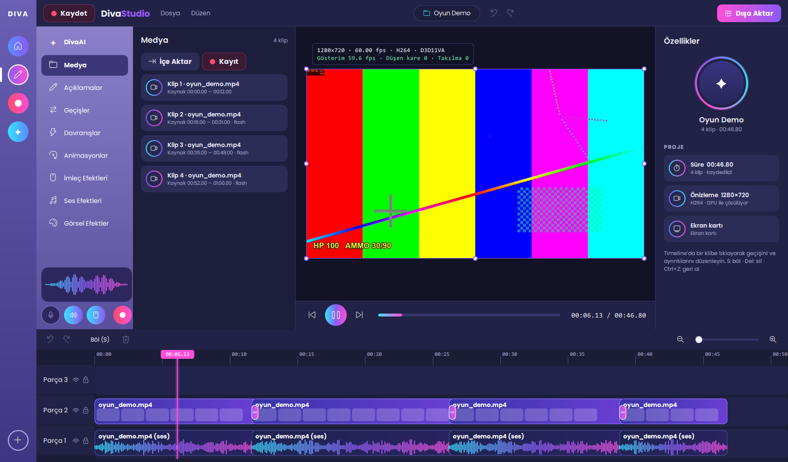

# DivaStudio

Açık kaynak ekran kaydı ve video düzenleme programı. Camtasia'ya alışkın kullanıcıların
yabancılık çekmeyeceği bir iş akışı, ama tamamen özgün kod, tasarım ve varlıklarla. İçinde
videoyu izleyip senin yerine düzenleyen bir yapay zekâ editörü var: **DivaAI**.

*Open-source screen recorder and video editor for Windows (macOS planned), with an AI editor. GPL-3.0-or-later.*



## Neler var

- **Kayıt:** ekran, bölge, sistem sesi ve mikrofon (ayrı ses izleri), 30/60/120 fps, F9 duraklat /
  F10 durdur, 3-2-1 geri sayım, kayda girmeyen kontrol çubuğu. Oyunlarda FPS'i korumak için
  kare CPU'ya inmez, kodlama GPU'nun ayrı video bloğunda yapılır.
- **Proje sistemi:** `.divaproj` kaydet/aç, son projeler, geri al/yinele, kaydedilmemiş değişiklik uyarısı.
- **Timeline:** böl (S), ripple sil (Del), 9 geçiş (çapraz geçiş, siyaha solma, flaş, silme,
  kaydırma, daire, yakınlaşma), yakınlaştırma, oynatma kafasıyla atlama.
- **Dışa aktarma:** 720p–4K, 30/60/120 fps, H.264 / HEVC / AV1, donanım kodlayıcı (NVENC / AMF / QSV)
  ya da CPU yedeği.
- **DivaAI:** "Oyunda öldüğüm kısımları kes, yerine geçiş ekle" gibi bir isteği yazarsın; DivaAI
  videoyu kontak sayfalarıyla izler, kesilecek yerleri kare kare bulur, uygun geçişi seçer ve
  düzenlemeyi yapar. Her adım Ctrl+Z ile geri alınabilir.
- **Başka projedeki düzenlemeyi uygula:** bir projede yapılan kesme ve geçişleri başka bir videoya
  birebir, orantılı ya da DivaAI ile "benzer anları bularak" uygular.

## DivaAI'yi çalıştırmanın iki yolu

1. **Uygulamada (Claude API):** DivaAI panelinde kendi Anthropic API anahtarını gir
   (platform.claude.com → Settings → API Keys). Anahtar Windows Kimlik Bilgileri'nde şifreli
   saklanır; kullandığın kadar ödersin. Model: Claude Opus 5.5.
2. **Claude Code ile (mevcut aboneliğin, API ücreti yok):** DivaStudio'nun MCP sunucusunu bir kez ekle:

   ```powershell
   claude mcp add -s user divastudio -- "C:\...\build\release\bin\divamcp.exe"
   ```

   Projeyi DivaStudio'da kaydet, Claude Code'a isteğini yaz. Claude Code aynı araçlarla düzenler;
   değişiklikler DivaStudio'da kendiliğinden görünür. Kullanım aboneliğinin limitlerinden düşer.

## Ölçümler (AMD ekran kartlı bir masaüstü sistem)

| | Sonuç |
|---|---|
| 4K60 donanım decode (HEVC / H.264 / AV1) | 434–458 fps |
| Editör önizlemesi 4K60 | 59,96 fps, 20 sn'de 1 düşen kare |
| Export 4K60 HEVC / AV1 / H.264 | 137 / 140 / 121 fps (2× gerçek zamandan hızlı) |
| 60 fps kayıt, GPU %100 yükteyken | sabit 60,0 fps, 0 geciken kare, CPU %0,5 |
| Kaydın oyuna etkisi (GPU'yu %100 kullanan sahne) | ortalama FPS'te ~%1–2 |
| DivaAI araç zinciri (tara → kes → geçiş → 1080p export, 60 sn video) | 7,7 sn |

Ekran kartı uyumluluğu: [docs/GPU_COMPATIBILITY.md](docs/GPU_COMPATIBILITY.md) ·
Mimari: [docs/ARCHITECTURE.md](docs/ARCHITECTURE.md)

## Derleme (Windows)

Gerekenler: Visual Studio 2022 Build Tools (C++), CMake ≥ 3.25, Ninja, Qt 6.8+ (msvc2022_64),
FFmpeg geliştirme paketi (ör. `winget install BtbN.FFmpeg.GPL.Shared.9.0`).

```powershell
.\scripts\build.ps1
.\build\release\bin\DivaStudio.exe
```

Qt ve FFmpeg başka yerdeyse `QTDIR` ve `FFMPEG_ROOT` ortam değişkenlerini ayarlayın.

## Araçlar

| Komut | Ne yapar |
|---|---|
| `divabench probe` | GPU'lar ve hangi kodlayıcıların açıldığı (açılmayanın nedeniyle) |
| `divabench decode <dosya>` / `export <girdi> <çıktı>` | Decode ve tam GPU export hattı ölçümü |
| `divarec [--region x,y,w,h] [--mic] [--seconds S] kayit.mkv` | Komut satırından kayıt |
| `divamcp` | DivaAI araçlarını Claude Code'a açan MCP sunucusu |
| `gpustress [saniye]` | Oyun benzeri GPU yükü; kaydın FPS etkisini ölçmek için |

## Henüz olmayanlar

Açıklamalar (callout/metin/şekil), davranışlar, animasyonlar, imleç ve ses efektleri, görsel
efektler: panelleri tasarım önizlemesi olarak duruyor. Gerçek zamanlı timeline önizlemesi yerine
düzenlemeden sonra arka planda hızlı bir 720p önizleme üretiliyor.

## Lisans

GPL-3.0-or-later, bkz. [LICENSE](LICENSE). FFmpeg'in GPL derlemesi (x264/x265 dahil) kullanılır.
